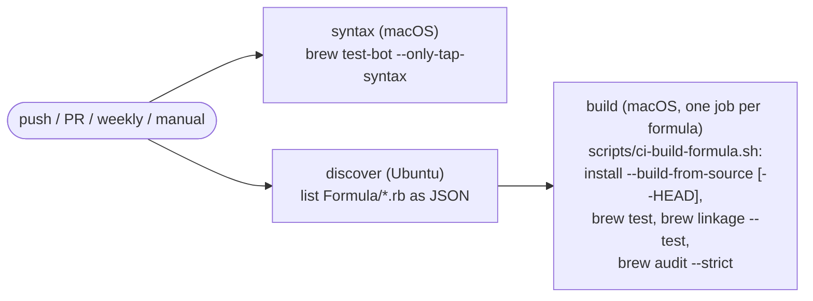

# AGENTS.md

This file provides guidance to AI coding agents (Claude Code, Codex, and others that read `AGENTS.md`) when working with code in this repository.

## Overview

This is a Homebrew tap (`FranklinChen/tap`) containing custom formulae for software not in the main Homebrew repository. Users install via `brew tap FranklinChen/tap`.

## Repository Structure

- `Formula/`: Homebrew formula Ruby files (one `.rb` per package)
  - `cm3.rb`: Critical Mass Modula-3 compiler (native Darwin C++ bootstrap, then a full self-compile into `libexec`, wrapped from `bin`)
  - `f2c.rb`: Fortran-to-C compiler (versioned release from netlib, with a `resource` block for `libf2c`)
  - `hugs.rb`: Hugs98+ Haskell implementation (head-only, from personal fork `FranklinChen/hugs98-plus-Sep2006`)
  - `sather.rb`: GNU Sather compiler (source build, depends on bdw-gc; wrapper sets SATHER_HOME)
  - `unicon.rb`: Unicon compiler (Icon descendant; conflicts with the icon formula)
  - `camllight.rb`: Caml Light bytecode ML system (head-only, from personal fork `FranklinChen/camllight`; wrappers bake LIBDIR in at build time)
- `scripts/ci-build-formula.sh`: builds one formula from source (adding `--HEAD` for head-only formulae), then runs `brew test`, `brew linkage --test` and `brew audit --strict` on it. CI runs it once per formula; locally it works the same but refuses a formula that is already installed (the script says why).
- `scripts/check-formula-locally.sh`: runs `ci-build-formula.sh` on a workstation against the formula in this working tree. It copies the formula into Homebrew's own clone of the tap, runs the check, and restores the clone on exit.
- `.github/workflows/tests.yml`: the CI workflow (see [Continuous Integration](#continuous-integration)).
- `.github/dependabot.yml`: weekly Dependabot updates for the SHA-pinned GitHub Actions.

## Common Commands

```bash
# Install a versioned formula
brew install FranklinChen/tap/f2c

# Install a head-only formula
brew install --HEAD FranklinChen/tap/hugs

# After editing a formula, before committing: what CI does, against THIS
# working tree (its header says why a bare `brew install` would build the
# old formula). Uninstall the formula first.
scripts/check-formula-locally.sh <formula>

# Test or audit an installed formula on its own. Both act on Homebrew's clone
# of the tap, not this working tree; Homebrew disabled the path form of audit.
brew test FranklinChen/tap/<formula>
brew audit --strict FranklinChen/tap/<formula>

# Style check of the whole tap, exactly as CI runs it: RuboCop over the
# formulae, plus shellcheck and shfmt over scripts/*.sh and actionlint over the
# workflows (`brew style --fix .` applies the correctable fixes)
brew style .

# Check upstream for a newer version (uses the formula's `livecheck` block)
brew livecheck FranklinChen/tap/<formula>
```

Homebrew refuses to build or audit anything when the installed Command Line Tools do not support the running macOS, even with Xcode.app selected. After a macOS upgrade, install the matching CLT first (`xcode-select --install`, or Software Update).

## Formula Conventions

- Each formula is a Ruby class inheriting from `Formula`.
- Formulae build from source using `system` calls to `make`/`configure`.
- These are old codebases, so most formulae suppress warnings-as-errors from pre-ANSI/K&R C on modern clang (`-Wno-error=implicit-function-declaration`, `-Wno-error=implicit-int`, and similar). Each threads the flags through whatever its build system exposes: `hugs`/`f2c` via `ENV["CFLAGS"]`, `camllight` via make's `OPTS`, `sather` via `inreplace` of its `Makefile`/`CONFIG`. Where `configure` comes from autoconf 2.72 or later, also pass `-std=gnu17`: that autoconf switches to `-std=gnu23` when it can, and C23 rejects K&R definitions (`hugs`; see its comments). See [macOS Porting Patterns](#macos-porting-patterns).
- Include a `test do` block that verifies the installed binary works. Assert on the program's output (`assert_equal`/`assert_match`), not just its exit status.
- Reference other formulae's paths with `formula_opt_bin("x")`/`formula_opt_prefix("x")`, not `Formula["x"].opt_bin`; `brew style` enforces this (`Homebrew/FormulaPathMethods`).
- Declare plain dependencies, not options (`:recommended`/`:optional`): a package's own configure script usually autodetects libraries whatever the option says, so an option cannot really turn a feature off. Homebrew's superenv already puts every dependency's `bin` on `PATH` and the non-keg-only ones' headers and libraries on the search paths, so set `CPPFLAGS`/`LDFLAGS` by hand only for a keg-only dependency or a build that ignores the environment. Where a build silently skips a feature whose library it cannot find (as hugs's bundled packages do), make `test do` use the feature, not check that its files exist: a skipped hugs package still installs its sources, so only importing it proves it built.
- Head-only formulae (like `hugs`) require `--HEAD` for installation; versioned formulae (like `f2c`) do not.
- Versioned formulae (`cm3`, `f2c`, `unicon`) carry a `livecheck` block so `brew livecheck` can detect new upstream releases. Head-only formulae have nothing to check.
- License stanzas use an SPDX expression where one fits (`unicon`, `sather`, `f2c`), otherwise `license :cannot_represent` (`cm3`), otherwise no stanza (`camllight`, `hugs`). Decide an SPDX match against the template in `spdx/license-list-XML`, whose `<alt>` and `<optional>` markup defines which wording may vary, not by eye. A comment beside the stanza, or where it would go, records the evidence for each formula's choice.
- Every formula must have a corresponding section in `README.md` documenting what the software is, the install command, and a brief history.
- Every formula must have update instructions in the "Updating Formulae" section below.

## Continuous Integration

`.github/workflows/tests.yml` runs on every push to `master`, on pull requests, weekly (Monday 09:17 UTC), and on demand. The weekly run matters because the head-only formulae build whatever their forks' `master` holds, and Homebrew itself keeps changing, so a formula can break with no commit here.



Design points a newcomer should know:

- **The build matrix is discovered, not listed.** The `discover` job lists `Formula/*.rb`, so adding a formula adds its CI job automatically; there is no second list to keep in sync.
- **`brew test-bot` is used only for tap syntax.** `--only-tap-syntax` runs `brew style`, `brew readall` and a non-strict `brew audit` over the whole tap. `brew style` on a tap is broader than its name suggests: besides RuboCop on the formulae it runs shellcheck (all optional checks enabled) and shfmt on `**/*.sh` and actionlint on the workflows, so those are gated without a step of their own.
- **Builds bypass `brew test-bot`.** Its formula mode has no `--HEAD`, so it cannot build the head-only formulae, and it always builds bottles, which this tap does not publish. `scripts/ci-build-formula.sh` reproduces the per-formula checks that matter here: `brew test`, `brew linkage --test` (a library linked without a declared dependency fails it), and `brew audit --strict` with the keg installed. It asks `brew info --json=v2` whether the formula has a stable version and adds `--HEAD` if not. The script also exports the variables test-bot sets when building (`HOMEBREW_NO_AUTO_UPDATE`, `HOMEBREW_NO_INSTALLED_DEPENDENTS_CHECK`), so installing a dependency does not upgrade unrelated preinstalled software on the runner.
- **`fail-fast: false`.** One broken formula must not cancel the jobs that would show the others still work.
- **Concurrency.** A newer push to a pull request cancels that PR's running checks; runs on `master` and scheduled runs always finish. This matters because a free account gets few concurrent macOS runners, shared across all its repositories, and every run needs one per formula.
- **Only the `syntax` job saves the RubyGems cache.** Build jobs install fewer gem groups, and `actions/cache` never overwrites an existing key, so a build job saving first would leave a cache the `syntax` job has to refill on every run. Build jobs use `actions/cache/restore`.
- **macOS only.** The formulae are macOS ports (see below); there is no Linux job, just as the tap does not claim Linux support.
- **The tap checkout is the workspace.** `Homebrew/actions/setup-homebrew` fetches this repository at the triggering commit, moves it into `GITHUB_WORKSPACE`, and symlinks it into Homebrew's `Taps/` directory. So the build job needs no `actions/checkout`, and `FranklinChen/tap/<formula>` resolves to the commit under test.
- **Actions are pinned by commit SHA** with the version in a trailing comment, as `brew tap-new` generates them, and Dependabot proposes updates weekly. When editing the workflow by hand, look up the latest release of each action at edit time and pin its SHA; never copy a version from memory.
- **Every shell script under `scripts/` must pass shellcheck and shfmt as `brew style .` runs them**, and the workflow must pass actionlint; the `syntax` job enforces all three through `brew style`.

The README carries the workflow's status badge.

## macOS Porting Patterns

Every package here predates Apple Silicon and most predate macOS, so the formulae share a handful of recurring fixes. Knowing these saves rediscovering them per formula:

- **Re-signing Mach-O binaries.** `cm3` and `unicon` both run `codesign -fs -` over their installed binaries at the end of `install`. Their build steps rewrite the executables after linking (cm3's backend relinks; unicon's `patchstr` embeds install paths), which invalidates the linker's ad-hoc code signature; an invalid signature makes macOS `SIGKILL` the binary on launch. The loop skips symlinks and non-Mach-O files, detected via `file -b`.
- **Baking the prefix in, or wrapping.** Homebrew installs into a versioned Cellar directory that is symlinked into the prefix, which breaks programs that locate their own runtime by path. Four solutions appear here: `cm3` installs its whole tree into `libexec`, because it finds `cm3.cfg` beside its own executable, and wraps each program from `bin` with `write_exec_script`; `camllight` bakes `LIBDIR` into its wrapper scripts at build time, so `LIBDIR` must be set on the `world` step, not just `install`; `sather` installs its runtime tree into `libexec` and ships a `bin/sacomp` shell wrapper that exports `SATHER_HOME`; `unicon` rewrites self-executing `icode` programs into wrappers that `exec iconx` with an absolute path, because icode cannot be read back through the Cellar symlink.
- **`inreplace` for Linux-isms.** `sather` is the heaviest example: it patches its `Makefile` and headers to swap `/lib/cpp` for `cc -E`, drop the missing `<values.h>`, and replace `echo -n` with `printf` (macOS `/bin/sh` `echo` has no `-n`). When a source build assumes GNU/Linux, prefer `inreplace` over carrying patch files.
- **Old-C warning suppression** (see Formula Conventions above) is the fourth recurring fix.
- **Distrust a package's Makefile rules for regenerating itself.** A Makefile that remakes `configure` from file timestamps and re-runs it without the original arguments silently moves the install to `/usr/local`; `make -o configure` marks it up to date (`hugs`; see its comments).
- **Hard-coded search paths outside the prefix.** A default path that checks `/usr/local` before the install's own files lets an older copy there shadow the Homebrew one; `inreplace` it out (`hugs`). A test of such a tool must pin its search path to the keg, or it can pass on someone else's files.

## Updating Formulae

When a new upstream release is available, update the formula as described below. Always recompute SHA256 hashes from the actual downloaded files (`curl -sL <url> | shasum -a 256`), never guess. A checksum failure on an unchanged formula means upstream replaced a file in place (cm3's release assets have been re-uploaded twice, see `d804c1d`): download it again and find out what changed before re-pinning.

### cm3.rb

Upstream is at <https://github.com/modula3/cm3>. The source and the bootstrap come from different places and are updated independently:

- **Source** (`url` + `sha256`): a git tag's archive, e.g. `archive/refs/tags/d5.12.1.tar.gz`. Tags appear without GitHub releases (d5.12.1 has none), so `livecheck` follows tags. To update, replace the tag and recompute the `sha256`; the version is inferred from the URL.
- **Bootstrap** (the `bootstrap` resource, one `url`/`sha256` pair under `on_arm` and one under `on_intel`): the native `cm3-boot-ARM64_DARWIN-<release>.tar.xz` and `cm3-boot-AMD64_DARWIN-<release>.tar.xz` assets of a published release. Each one's `CMakeLists.txt` sets its own `M3Target`, so stage 1 builds a native compiler; never substitute the `AMD64_LINUX` asset. Change the bootstrap only when a newer release publishes Darwin assets.

**The bootstrap must be compatible with the source.** An older bootstrap compiling newer source is the normal pattern; the reverse can fail. The comment on the `bootstrap` resource records why the current pins pair as they do and where upstream builds the same pairing. Before bumping either, check which bootstrap upstream's `.github/workflows/make-release.yml` uses at the new tag, then run `scripts/check-formula-locally.sh cm3`.

**ODBC needs an explicit library path.** `install` appends a `SYSTEM_LIBS{"ODBC"}` override for keg-only `libiodbc` to the target's config (the comment there explains why). Without it, stage 2 stops at `ld: library 'iodbc' not found` while linking `m3odbc`. Re-check it on a bump, since upstream may fix the path.

### f2c.rb

Upstream is at <https://www.netlib.org/f2c/>. The URLs (`src.tgz`, `libf2c.zip`) are rolling tarballs that always point to the latest version; they do not change between releases.

1. **`version`**: update the date string (e.g. `20250303`) to reflect the new release date (check the netlib page or the source for a date).
2. **`sha256`**: recompute for both the main `src.tgz` and the `libf2c` resource `libf2c.zip`.

### hugs.rb

Head-only formula: always builds from the latest git commit of <https://github.com/FranklinChen/hugs98-plus-Sep2006>. No version or SHA256 to update. Only update if dependencies or build steps change. The fork's own `tools/ci/build.sh` is the reference recipe (its `CFLAGS` and `make -o configure` are mirrored in the formula); compare against it when the fork changes. Its test loads the module list from the fork's `tools/ci/check.py`; keep the two in step.

### sather.rb

Dead project (last release 1.2.3 in July 2007, declared orphaned in 2002). No updates expected. If somehow a new release appeared on <https://ftp.nluug.nl/gnu/sather/>, update the `url` tag and recompute `sha256`.

### unicon.rb

Upstream releases are at <https://github.com/uniconproject/unicon/releases>.

1. **`url`**: replace the tag (e.g. `13.2` to `13.3`).
2. **`sha256`**: recompute for the new archive.

### camllight.rb

Head-only formula: always builds from the latest git commit of <https://github.com/FranklinChen/camllight>. No version or SHA256 to update. The build passes the project's modern-compiler warning flags through make's `OPTS` variable, and sets `BINDIR`/`LIBDIR` on the `world` step (not only on `install`) because the wrapper scripts (`camlc`, `camllight`, `camlmktop`) bake `LIBDIR` in at build time. Only update if build steps change. If a stable release tag is ever cut on the camllight repo, switch from head-only to `url` + `sha256` (as in `f2c`/`unicon`).
